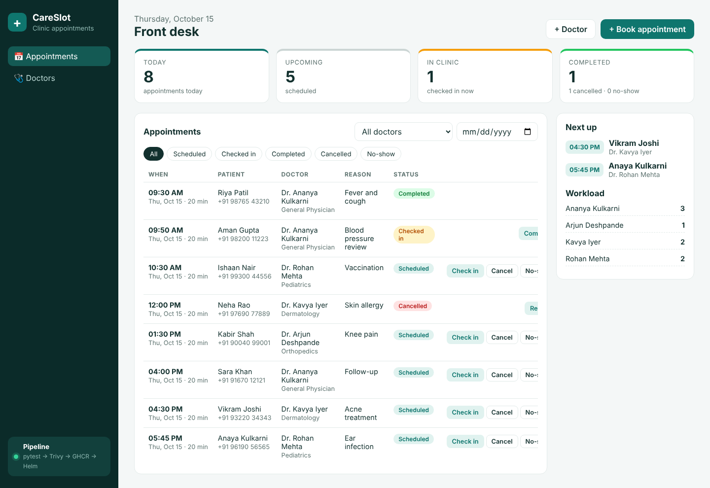

# Session 21 – Final DevOps Project

**Name:** Saniya Sanjiv Patil · **Roll No:** 24bcs10246 · **Batch:** B

## CareSlot: clinic appointment booking

My capstone application is **CareSlot**, a front-desk app for a clinic. It manages doctors, books patient appointments without double-booking, and tracks each visit (scheduled → checked in → completed / cancelled / no-show). It is a React + FastAPI + PostgreSQL app, and it goes through the full DevOps lifecycle from Session 21: pytest → Docker → GitHub Actions → Trivy → GHCR → Terraform (AWS VPC + EKS) → Helm → Ingress → HPA → Prometheus + Grafana → troubleshooting.

**Project folder and full documentation:** [`careslot/README.md`](./careslot/README.md)

**Pipeline:** [`.github/workflows/session21-final-project.yml`](../.github/workflows/session21-final-project.yml) · runs in the [Actions tab](https://github.com/Saniya1613/devops-homework/actions/workflows/session21-final-project.yml)

> An earlier version of this folder held my adaptation of the instructor's TaskBoard reference project (`final-devops-project/`). The grading rubric requires an application domain of my own, so I replaced it with CareSlot and reused the DevOps practices I had already built (hardened Helm chart, DevSecOps gates, troubleshooting labs). The TaskBoard version is still in the Git history (commit `758b191`).
